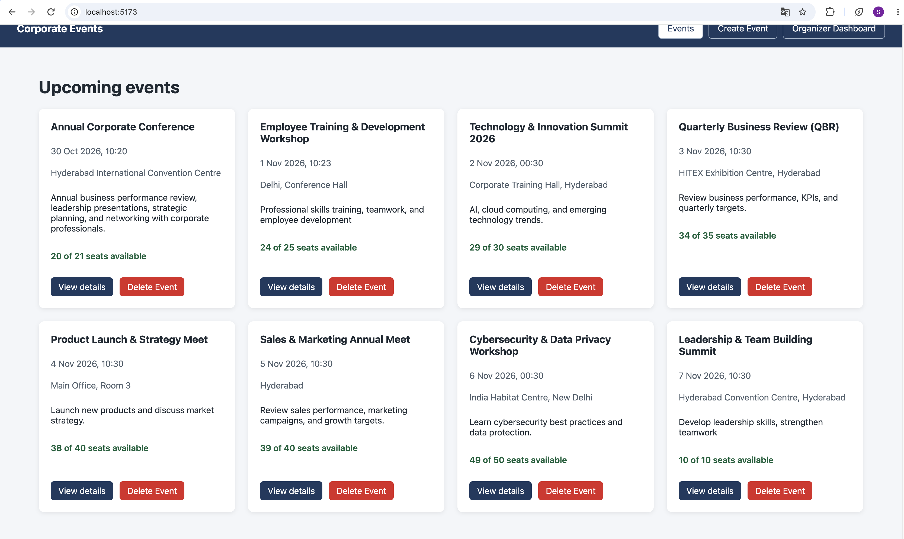
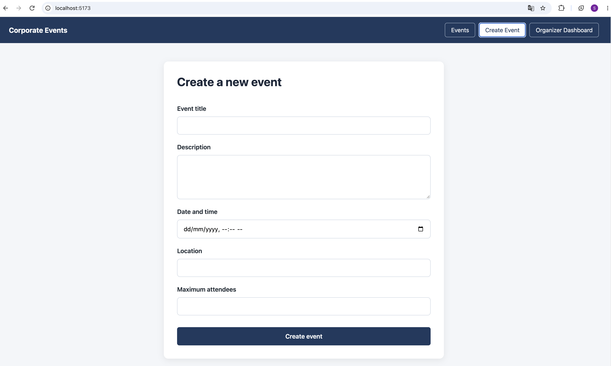
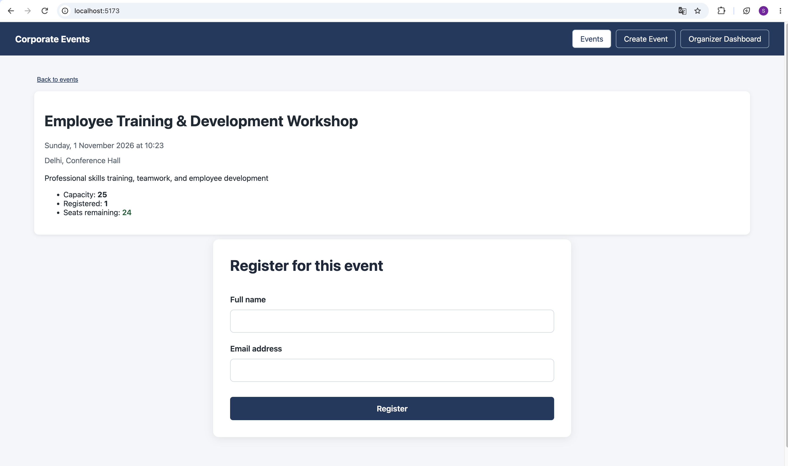
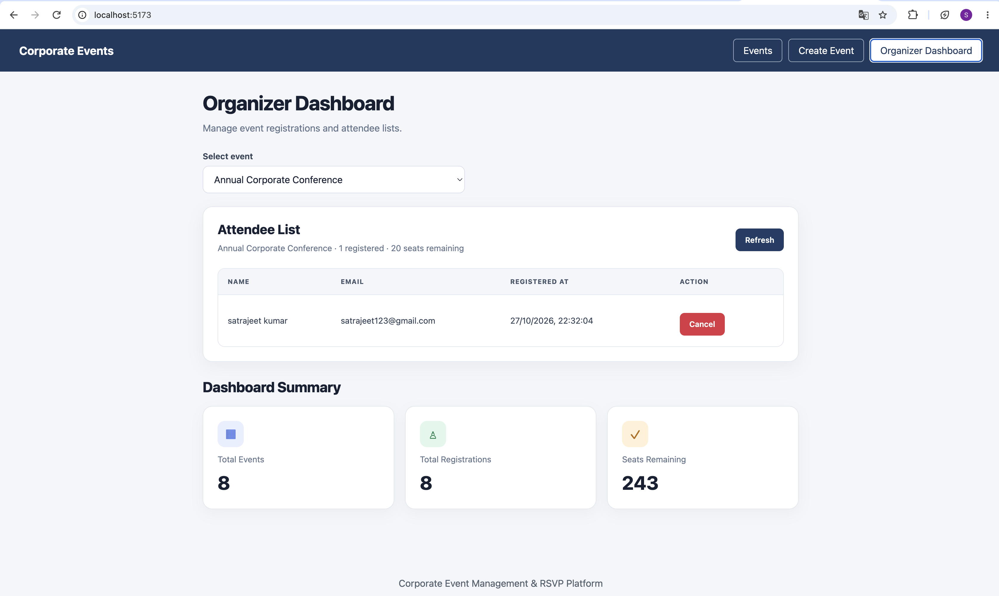

# Event RSVP Platform

A full-stack Corporate Event RSVP Platform built using **React, Flask, and MongoDB Atlas**. Users can browse upcoming events, create events, view event details, register attendees, manage registrations, and track event capacity.

## Features

- Create and list events
- View event details
- Register attendees
- Prevent duplicate registrations for the same event and email
- View attendee lists and remaining capacity
- Cancel registrations
- Delete events when permitted
- Backend and database health check
- Automated backend API tests
- CORS configuration and automated CORS tests

## Tech Stack

- **Frontend:** React, JavaScript, Vite, CSS
- **Backend:** Python, Flask, REST API
- **Database:** MongoDB Atlas with PyMongo
- **Testing:** Python `unittest`, Vitest, React Testing Library
- **Version Control:** Git and GitHub

## Screenshots

### Events Page


### Create Event


### Event Details and Registration


### Organizer Dashboard



## Project Structure

```text
event-rsvp-platform/
├── backend/
│   ├── database/
│   ├── routes/
│   ├── services/
│   ├── tests/
│   ├── app.py
│   ├── config.py
│   ├── requirements.txt
│   └── .env.example
├── frontend/
│   ├── src/
│   ├── package.json
│   ├── vite.config.js
│   └── index.html
├── .gitignore
└── README.md
```

## Prerequisites

Install the following before running the project:

- Python 3
- Node.js and npm
- MongoDB Atlas (or a local MongoDB instance)
- Git

## Environment Configuration

The backend reads configuration from environment variables.

| Variable | Default value | Purpose |
|---|---|---|
| `MONGO_URI` | Set through environment/configuration | MongoDB Atlas or local MongoDB connection URI |
| `DB_NAME` | `event_rsvp` | Development database name |
| `FRONTEND_ORIGIN` | `http://localhost:5173` | Allowed frontend origin |
| `PORT` | `5001` | Backend port |

The example configuration is available in `backend/.env.example`.

**Important:** The application currently reads these values using `os.environ`. The `.env.example` file documents the variables; it does not automatically load them. Set the environment variables in your terminal or deployment environment before starting the backend if you need values other than the defaults.

Do not commit `.env` files, passwords, database credentials, API keys, or other secrets to GitHub.

## Run the Backend

From the project root, run:

```bash
cd backend
python3 -m venv .venv
source .venv/bin/activate
pip install -r requirements.txt
python app.py
```

The backend runs at:

http://127.0.0.1:5001

Health endpoint:

http://127.0.0.1:5001/api/health

The health endpoint reports whether the API is running and whether MongoDB is available.

## Run the Frontend

Open a **second terminal** from the project root:

```bash
cd frontend
npm install
npm run dev
```

Open the local URL displayed by Vite, usually:

http://localhost:5173

Keep both the backend and frontend terminals running while using the application.

If the frontend needs a different API base URL, configure `VITE_API_BASE_URL` according to the frontend API client setup.

## API Endpoints

| Method | Endpoint | Purpose |
|---|---|---|
| GET | `/api/health` | Check backend and database health |
| POST | `/api/events` | Create an event |
| GET | `/api/events` | List upcoming events |
| GET | `/api/events/<event_id>` | Get event details |
| DELETE | `/api/events/<event_id>` | Delete an eligible event |
| POST | `/api/events/<event_id>/registrations` | Register an attendee |
| GET | `/api/events/<event_id>/attendees` | List attendees and capacity details |
| DELETE | `/api/events/<event_id>/registrations/<registration_id>` | Cancel a registration |

### Common HTTP Responses

- `200 OK` — Request completed successfully.
- `201 Created` — Event or registration created successfully.
- `400 Bad Request` — Invalid JSON or validation errors.
- `404 Not Found` — Event or registration not found.
- `409 Conflict` — Duplicate registration or event cannot be deleted because registrations exist.
- `422 Unprocessable Entity` — Event has no available seats.
- `500 Internal Server Error` — Unexpected server error.

The exact response depends on the endpoint and the reason for failure.

## Run Automated Backend Tests

The backend test suite covers event endpoints, registration behaviour, CORS headers, database configuration, health checks, and database index setup.

The tests use a **separate MongoDB instance** at `127.0.0.1:27018` and the `event_rsvp_test` database. Make sure that test MongoDB instance is running before executing the tests.

From the project root, run:

```bash
cd backend
source .venv/bin/activate
python -m unittest discover -s tests -t . -p 'test_*.py' -v
```

The latest verified local run completed **19 backend tests successfully**.

### Run Frontend Tests

From the project root, open a terminal and run:

```bash
cd frontend
npm test -- --run
```

The previously verified frontend test run passed **5 tests**.

### Run Frontend Lint and Build

From the project root:

```bash
cd frontend
npm run lint
npm run build
```

Both commands passed in the previously verified local run.

## Security Notes

- Keep credentials and `.env` files out of version control.
- Use environment variables for configuration and secrets.
- Use the dedicated test database for automated tests.
- Never point automated tests at the development database.
- Configure `FRONTEND_ORIGIN` to match the trusted frontend origin in each environment.
- Do not expose database credentials in source code, logs, screenshots, or public repositories.
- Review deployment settings before making the application publicly accessible.

## Project Status

The project includes event creation and listing, event details, attendee registration and cancellation, organizer attendee management, capacity tracking, a React frontend, Flask REST APIs, and MongoDB integration. The current development setup has displayed eight events in the frontend and returned eight events from the events API.

The project has been tested locally. Run the backend tests, frontend tests, lint, and production build again before claiming that the latest version passes all checks. Review credentials and deployment settings before publishing.

## Author

Satrajeet Kumar
